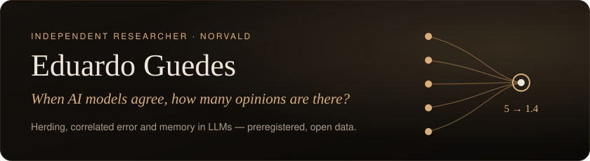
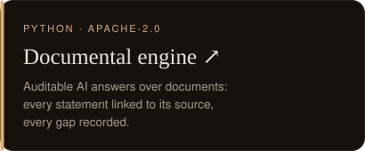
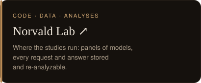
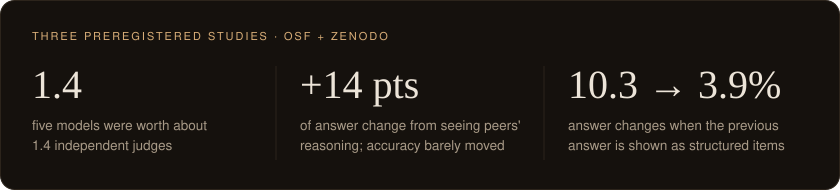

**Papers (Zenodo):** [How many contribute and how many just agree?](https://doi.org/10.5281/zenodo.24265239) · [How many models are five worth?](https://doi.org/10.5281/zenodo.24265355) · [Does the format of the previous answer anchor the review?](https://doi.org/10.5281/zenodo.24265357)

**Preregistrations (OSF):** [aw9vf](https://osf.io/aw9vf) · [5dpjr](https://osf.io/5dpjr) · [46erj](https://osf.io/46erj)

**Elsewhere:** [ORCID](https://orcid.org/0009-0003-9960-3337) · [Manifund](https://manifund.org/projects/how-external-data-affects-the-memory-of-ai-agents) · [norvald.com.br](https://norvald.com.br) · contato@norvald.com.br

Pesquisador independente em Brasília. Estudo como modelos de IA concordam, erram juntos e lembram — com pré-registro e dados abertos.
